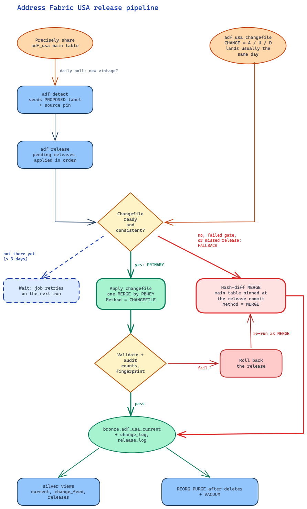

# adf-usa-merge-pipeline

Incremental release pipeline for **Address Fabric USA** (`adf_usa`, Delta Sharing). Every Precisely release
(weekly `2026.10.1`, `2026.10.2`, ... and the monthly `X.0`) is applied to one table, `bronze.adf_usa_current`, so only
records that were **ADDED / UPDATED / DELETED** carry the new release version. Unchanged rows are never rewritten, so
downstream jobs only reprocess the change set.

## Architecture



Source: `docs/architecture.excalidraw` (open it at excalidraw.com to edit, then export the PNG).

* **Primary path: the changefile** (`precisely_product_share.precisely_db_property_graph.adf_usa_changefile`, rows with
  `CHANGE` = A/U/D). Precisely now publishes it the same day as the main table's release marker; it holds only the latest release.
  LATITUDE/LONGITUDE are `decimal(11,6)` and are cast to double before hashing (hash-identical to the main table).
* **Fallback and audit: the hash MERGE** against the main table pinned at the vendor's release commit. After a changefile
  apply, a content fingerprint is compared to the pinned main table (audit PASSED; SKIPPED if the 7-day pin has expired).
  If any gate, validation or audit fails, the release is rolled back and the MERGE runs. The reason is stored in
  `ops.release_log.fallback_reason`.
* A release missed for any reason is always applied by the MERGE (the changefile only holds the latest one).
* Deletes are tombstones: attributes and `row_hash` are NULLed, PBKEY + status + release stay (NJ privacy removals are permanent).

### Tables (catalog `address_book`)

| Table / view | Purpose |
|---|---|
| `bronze.adf_usa_current` | Current state, one row per PBKEY, with `row_hash`, `status` (BASELINE/ADDED/UPDATED/DELETED), `release_version`, `release_seq`, `reappeared` |
| `bronze.adf_usa_change_log` | Slim per-release history (key, change type, hashes) |
| `ops.release_label` | Authority for release labels: source pin, vendor counts from the release document, PROPOSED/CONFIRMED |
| `ops.release_log` | One row per release run: state, counts, `method`, `fallback_reason`, `audit`, rollback pointer |
| `silver.adf_usa_current` | Consumer view: live rows only, no hash columns |
| `silver.adf_usa_change_feed` | Consumer view: the rows changed after the baseline, including tombstones |
| `silver.adf_usa_change_log`, `silver.adf_usa_releases` | Consumer views of the change history and the release list |

Consumers get `USE CATALOG` on the catalog and `USE SCHEMA`, `SELECT` on `silver` only (`sql/grants.template.sql`).

## Prerequisites

* Databricks CLI >= 1.18 (use the latest; v0.295.0 fails deploys with `openpgp: key expired`), see
  [Install or update the Databricks CLI](#install-or-update-the-databricks-cli) below
* An authenticated profile for your workspace (replace `<profile>` in the commands below with its name; list yours with `databricks auth profiles`)
* Python 3.10+ with `build`, installed **inside `.venv`** (not the global Python), for the wheel that the bundle builds
* `gh` and `git` for the GitHub side
* Permission to create schemas in the catalog and read the shared catalogs `precisely_product_share.*`
* Serverless compute enabled in the workspace

### Install or update the Databricks CLI

Check what you have: `databricks --version`.

| OS | Install | Update |
|----|---------|--------|
| Windows | `winget install Databricks.DatabricksCLI` | `winget upgrade Databricks.DatabricksCLI` |
| macOS | `brew tap databricks/tap && brew install databricks` | `brew upgrade databricks` |

Open a new terminal afterwards and re-check the version. On Windows, if the upgrade fails with `Access is denied`,
close other terminals/editors and retry from an elevated PowerShell, or `winget uninstall` then `winget install`.

### Log in to the workspace

Opens a browser for SSO. Use your workspace URL (no trailing path such as `/browse`) and a profile name of your choice:

```bash
databricks auth login --host https://<your-workspace>.cloud.databricks.com --profile <profile>
databricks auth profiles    # the profile should show Valid: YES
```

The bundle does not pin a workspace host. It deploys to whichever workspace the `--profile` points at, so always pass
`--profile <profile>` (or set `DATABRICKS_HOST`). Logins expire; if you see `Refresh token is invalid`, log in again.

## Step by step: push to Databricks and run end to end

All commands run from the repo root. Replace `<profile>` with your profile name (from `databricks auth profiles`) and `address_book` if your catalog differs.

**Shell:** the `bash` blocks work as written on macOS/Linux (bash or zsh) and on Windows in **Git Bash** (installed
with Git). Steps 5, 6 and 7 also have a **Windows PowerShell** version, because the bash syntax there
(`$(...)`, heredoc, `/tmp`, backslash escapes) does not work in PowerShell. Use PowerShell, not `cmd.exe`, on Windows.
Keep the venv active so `python` is the venv's Python (`source .venv/bin/activate` on macOS/Linux,
`source .venv/Scripts/activate` in Git Bash, `.venv\Scripts\Activate.ps1` in PowerShell).

### 1. Get the code from GitHub main

```bash
git clone https://github.com/PreciselyCloudNative/adf-usa-merge-pipeline.git
cd adf-usa-merge-pipeline
```

### 2. Set up the Python environment and run the local tests (no Databricks needed)

Create the venv once (`python3 -m venv .venv` on macOS/Linux, `python -m venv .venv` on Windows), then:

macOS / Linux:

```bash
.venv/bin/python -m pip install -e '.[dev]' build
.venv/bin/python -m pytest tests -q
```

Windows (PowerShell):

```powershell
.venv\Scripts\python.exe -m pip install -e ".[dev]" build
.venv\Scripts\python.exe -m pytest tests -q
```

`build` is needed in step 3. Install it in the venv: a uv- or system-managed Python refuses global installs
(`externally-managed-environment`).

### 3. Deploy the bundle (builds the wheel, uploads code, creates the job)

Activate the venv first so the bundle's `python -m build --wheel` finds the `build` package
(`source .venv/bin/activate` on macOS/Linux, `source .venv/Scripts/activate` in Windows Git Bash,
`.venv\Scripts\Activate.ps1` in Windows PowerShell). If the deploy fails with `python: command not found`
(common on macOS, which only ships `python3`) or `No module named build`, the venv is not active: activate it and retry. Then:

```bash
databricks bundle validate --strict -t prod --profile <profile>
databricks bundle deploy -t prod --profile <profile>
```

This creates the job `adf-usa-release` (tasks `adf-detect` -> `adf-release`, serverless, daily schedule) and syncs the
repo to `/Workspace/Users/<you>/.bundle/adf-usa-merge-pipeline/files`. Catalog and schema names are bundle variables
in `databricks.yml` (`--var catalog=...` to override).

### 4. Create the schemas and tables

```bash
python scripts/apply_ddl.py --profile <profile> --catalog address_book
```

Creates `bronze`, `ops` and `silver` plus all tables and views from `sql/ddl/`. Safe to re-run.

### 5. Pick the baseline release and freeze it

A fresh install starts from whatever release Precisely has published **now**. `scripts/latest_release.py` asks the share
which one that is and prints JSON (`{"release_version": "<X.Y.Z>", "source_version": <N>, "row_count": <rows>, "committed_at": "..."}`).
The commands below read `release_version` and `source_version` from that JSON and copy that version of the main table
into `adf_usa_baseline`, so there is nothing to copy and paste. The share keeps only about 7 days of history, so do this
right away. Replace `<profile>` in both commands. They also print the three values that step 6 needs.

> **If `latest_release.py` stops with "older than the share's time-travel window":** the newest release is still
> the latest, but Precisely has already vacuumed its data files, so it can no longer be copied. Do not continue and do
> not pick a newer version by hand (the share changes between releases, so the row count would not match the release
> label). Wait for the next release, or ask Precisely to extend the share's `delta.deletedFileRetentionDuration`.

Git Bash / macOS / Linux:

```bash
J=$(python scripts/latest_release.py --profile <profile>)
REL=$(python -c "import sys,json; print(json.loads(sys.argv[1])['release_version'])" "$J")
VER=$(python -c "import sys,json; print(json.loads(sys.argv[1])['source_version'])" "$J")
ROWS=$(python -c "import sys,json; print(json.loads(sys.argv[1])['row_count'])" "$J")

databricks experimental aitools tools query --profile <profile> "CREATE TABLE address_book.bronze.adf_usa_baseline TBLPROPERTIES ('release_version' = '$REL') AS SELECT * FROM precisely_product_share.precisely_db_property_graph.adf_usa VERSION AS OF $VER"
echo "release_version=$REL source_version=$VER expected_rows=$ROWS"
```

Windows PowerShell:

```powershell
$r = python scripts/latest_release.py --profile <profile> | ConvertFrom-Json

databricks experimental aitools tools query --profile <profile> "CREATE TABLE address_book.bronze.adf_usa_baseline TBLPROPERTIES ('release_version' = '$($r.release_version)') AS SELECT * FROM precisely_product_share.precisely_db_property_graph.adf_usa VERSION AS OF $($r.source_version)"
"release_version=$($r.release_version) source_version=$($r.source_version) expected_rows=$($r.row_count)"
```

The row count must equal `row_count` from the previous command (the bootstrap checks it). Check it with
`databricks experimental aitools tools query --profile <profile> "SELECT count(*) FROM address_book.bronze.adf_usa_baseline"`.

### 6. Load `adf_usa_current` from the baseline and seed the labels

`scripts/bootstrap_load_current.py` is a notebook. It hashes the baseline into `adf_usa_current` (status BASELINE, seq 1),
seeds `ops.release_label` with the baseline release and writes the baseline row of `ops.release_log`.
It refuses to run twice. The three values (`release_version`, `source_version`, `row_count`) come from the shell
variables that step 5 set (`$REL`, `$VER`, `$ROWS` in bash, `$r` in PowerShell), so **run this step in the same terminal
as step 5**. If you opened a new terminal, do not re-run `latest_release.py`: the share may have published a newer
release since the baseline was frozen. Set the variables by hand from the values step 5 printed instead
(for example `REL=2026.10.2 VER=213 ROWS=194475857`, or `$r = @{release_version="2026.10.2"; source_version=213; row_count=194475857}`).

```bash
ROOT=/Workspace/Users/<you>/.bundle/adf-usa-merge-pipeline/files
databricks workspace import $ROOT/scripts/bootstrap_load_current --file scripts/bootstrap_load_current.py \
  --format SOURCE --language PYTHON --overwrite --profile <profile>
cat > /tmp/bootstrap.json <<JSON
{"run_name": "adf-bootstrap",
 "tasks": [{"task_key": "main",
   "notebook_task": {"notebook_path": "$ROOT/scripts/bootstrap_load_current",
                     "base_parameters": {"catalog": "address_book", "src_path": "$ROOT/src",
                                         "baseline_table": "adf_usa_baseline",
                                         "release_version": "$REL",
                                         "source_version": "$VER",
                                         "expected_rows": "$ROWS"}},
   "environment_key": "e"}],
 "environments": [{"environment_key": "e", "spec": {"client": "4"}}]}
JSON
databricks jobs submit --json @/tmp/bootstrap.json --profile <profile>
```

Windows PowerShell (replace `<you>` and `<profile>`). The closing `"@` must stay at the start of its line. The job file is
written without a BOM, to your temp folder (like `/tmp` in the bash version), so nothing is left in the repo. The
`@` path is inside double quotes because PowerShell treats a bare `@` as splatting:

```powershell
$ROOT = "/Workspace/Users/<you>/.bundle/adf-usa-merge-pipeline/files"
databricks workspace import "$ROOT/scripts/bootstrap_load_current" --file scripts/bootstrap_load_current.py --format SOURCE --language PYTHON --overwrite --profile <profile>
$json = @"
{"run_name": "adf-bootstrap",
 "tasks": [{"task_key": "main",
   "notebook_task": {"notebook_path": "$ROOT/scripts/bootstrap_load_current",
                     "base_parameters": {"catalog": "address_book", "src_path": "$ROOT/src",
                                         "baseline_table": "adf_usa_baseline",
                                         "release_version": "$($r.release_version)",
                                         "source_version": "$($r.source_version)",
                                         "expected_rows": "$($r.row_count)"}},
   "environment_key": "e"}],
 "environments": [{"environment_key": "e", "spec": {"client": "4"}}]}
"@
[System.IO.File]::WriteAllText("$env:TEMP\bootstrap.json", $json)
databricks jobs submit --json "@$env:TEMP\bootstrap.json" --profile <profile>
```

If the run fails with `Workload failed`, read the real error: `databricks jobs get-run <run_id> --profile <profile>`, take the
`run_id` of the `main` task, then `databricks jobs get-run-output <task_run_id> --profile <profile>` (see `error` and `error_trace`).

Check: `SELECT status, count(*) FROM address_book.bronze.adf_usa_current GROUP BY 1` gives `row_count` rows, all BASELINE.

### 7. Create the consumer grants (once)

```bash
databricks experimental aitools tools query --profile <profile> "GRANT USE CATALOG ON CATALOG address_book TO \`account users\`"
databricks experimental aitools tools query --profile <profile> "GRANT USE SCHEMA, SELECT ON SCHEMA address_book.silver TO \`account users\`"
```

Windows PowerShell: use single quotes, so the backticks around the group name are literal:

```powershell
databricks experimental aitools tools query --profile <profile> 'GRANT USE CATALOG ON CATALOG address_book TO `account users`'
databricks experimental aitools tools query --profile <profile> 'GRANT USE SCHEMA, SELECT ON SCHEMA address_book.silver TO `account users`'
```

Use a narrower group when you have one (see `sql/grants.template.sql`).

### 8. Run the pipeline

```bash
databricks bundle run adf_usa_release -t prod --profile <profile>
```

`adf-detect` finds vintages newer than the baseline and seeds PROPOSED labels. `adf-release` applies every pending release
in order. The task output is JSON; look for `"method": "CHANGEFILE"` and `"audit": "PASSED"`.

The job takes three parameters: `catalog`, `source_table` (main table share) and `changefile_table` (changefile share).
The defaults are set in `databricks.yml`; to use others for a run add
`--params catalog=<catalog>,source_table=<share>.<schema>.adf_usa,changefile_table=<share>.<schema>.adf_usa_changefile`
(full table in "Operating it" below).
If the baseline is already the newest release, the run reports nothing pending: that is normal. Run it again after the
next Precisely release (weekly), once its changefile has landed (normally the same day).

### 9. Verify

```sql
-- what happened, and how
SELECT release_version, release_seq, state, method, audit, fallback_reason, added, updated, deleted
FROM address_book.ops.release_log ORDER BY release_seq;

-- current table: live rows + tombstones
SELECT status, count(*) FROM address_book.bronze.adf_usa_current GROUP BY 1;

-- consumers
SELECT * FROM address_book.silver.adf_usa_releases;
SELECT status, release_version, count(*) FROM address_book.silver.adf_usa_change_feed GROUP BY 1, 2;
```

Per applied release expect `method = CHANGEFILE`, `audit = PASSED`, added/updated/deleted equal to the Precisely document, and
live rows in `silver.adf_usa_current` equal to the release's row count. A `MERGE` method with a `fallback_reason` means the
changefile was rejected and the MERGE took over.

### 10. Drop the baseline table, schedule

After the baseline is loaded and verified:

```bash
databricks experimental aitools tools query --profile <profile> "DROP TABLE address_book.bronze.adf_usa_baseline"
```

The job runs daily at 06:30 UTC (`resources/adf_usa_release.job.yml`, `pause_status: UNPAUSED`). To pause it, set
`PAUSED`, push through a PR and redeploy (step 3). Failures email `alert_email` (`databricks.yml`), which defaults to the user who deployed the bundle (`${workspace.current_user.userName}`); override with `--var alert_email=...`.

## Operating it

* **Job parameters** (job `adf-usa-release`, defaults from the bundle variables in `databricks.yml`):

  | Parameter | Default | Meaning |
  |---|---|---|
  | `catalog` | `address_book` | Target catalog (schemas `bronze`, `ops`, `silver`) |
  | `source_table` | `precisely_product_share.precisely_db_property_graph.adf_usa` | Main table Delta Share |
  | `changefile_table` | `precisely_product_share.precisely_db_property_graph.adf_usa_changefile` | Changefile Delta Share |

  Override for one run: `databricks bundle run adf_usa_release -t prod --profile <profile> --params catalog=my_catalog,source_table=...,changefile_table=...`
  (or "Run now with different parameters" in the UI). To change the scheduled defaults, edit the variables in `databricks.yml`
  (or `--var catalog=...` at deploy). A new catalog also needs steps 4 to 6 (DDL, baseline, bootstrap) run against it,
  using that catalog name. The pins in `ops.release_label` are Delta versions of the source table, so switching
  `source_table` on an existing install also means re-pinning (version numbers differ between shares).
* **Configuration**: job parameters in `resources/adf_usa_release.job.yml` (`use-changefile`, `audit`,
  `changefile-wait-days` (default 3), `require-confirmed`, `allow-large-change`).
  `changefile-wait-days: 0` applies by MERGE right away instead of waiting for the changefile.
* **Confirm release counts**: the labels carry the numbers from the Precisely release document. For a new release,
  `UPDATE ops.release_label SET status='CONFIRMED', vendor_added=..., vendor_updated=..., vendor_deleted=...,
  confirmed_by=..., confirmed_at=current_timestamp() WHERE release_version='...'`, ideally before the changefile apply.
* **Roll back the newest release**: `adf_merge.release.rollback_release` restores `adf_usa_current` to the previous release's
  Delta version and clears the change log. It only works inside the 7-day Delta retention.
* **Maintenance** runs inside `adf-release`: `REORG ... PURGE` after releases with deletes, `VACUUM` (7-day retention).
* **Failed run**: the release stays FAILED in `ops.release_log`; fix the cause and re-run the job (reruns are idempotent).

## Tests

* Local: `.venv/bin/python -m pytest tests -q` on macOS/Linux, `.venv\Scripts\python.exe -m pytest tests -q` on Windows (hashing, release helpers, detection).
* Synthetic scenarios on Databricks (26: normal, resurrection, rebuild, schema drift, rollback, missed releases, changefile
  fallbacks, ...). They use throwaway `zz_syn_*` schemas that are dropped afterwards:

  ```bash
  databricks workspace import $ROOT/scripts/run_synthetic --file scripts/run_synthetic.py --format SOURCE --language PYTHON --overwrite --profile <profile>
  # then submit it like step 6 with base_parameters {"root": "$ROOT", "catalog": "address_book"}
  ```

## Repo layout

```
src/adf_merge/   hashing, release (MERGE, gates, validate, rollback), changefile, detect, maintenance, cli
sql/ddl/         schemas, tables, silver views (${catalog} placeholder)
sql/migrations/  one-offs for tables created before a change
scripts/         apply_ddl.py, bootstrap_load_current.py (notebook), run_synthetic.py, run_release.py, run_maintenance.py
resources/       the DAB job; databricks.yml = bundle, variables, target
tests/           unit tests and tests/synthetic/scenarios.py
design/          the agent design rounds (history)
CLAUDE.md        project log and decisions
```
