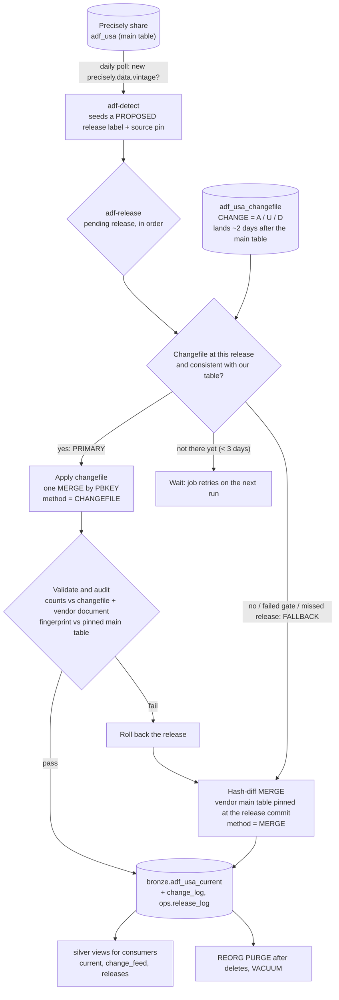

# adf-usa-merge-pipeline

Incremental release pipeline for **Address Fabric USA** (`adf_usa`, Delta Sharing). Every Precisely release
(weekly `2026.10.1`, `2026.10.2`, ... and the monthly `X.0`) is applied to one table, `bronze.adf_usa_current`, so only
records that were **ADDED / UPDATED / DELETED** carry the new release version. Unchanged rows are never rewritten, so
downstream jobs only reprocess the change set.

## Architecture



* **Primary path: the changefile** (`precisely_product_share.precisely_db_property_graph.adf_usa_changefile`, rows with
  `CHANGE` = A/U/D). It lands about two days after the main table's release marker and holds only the latest release.
  LATITUDE/LONGITUDE are `decimal(11,6)` and are cast to double before hashing (hash-identical to the main table).
* **Fallback and audit: the hash MERGE** against the main table pinned at the vendor's release commit. After a changefile
  apply, a content fingerprint is compared to the pinned main table (audit PASSED; SKIPPED if the 7-day pin has expired).
  If any gate, validation or audit fails, the release is rolled back and the MERGE runs. The reason is stored in
  `ops.release_log.fallback_reason`.
* A release missed for any reason is always applied by the MERGE (the changefile only holds the latest one).
* Deletes are tombstones: attributes and `row_hash` are NULLed, PBKEY + status + release stay (NJ privacy removals are permanent).

### Tables (catalog `address_book`)

| Table / view | Purpose |
|---|---|
| `bronze.adf_usa_current` | Current state, one row per PBKEY, with `row_hash`, `status` (BASELINE/ADDED/UPDATED/DELETED), `release_version`, `release_seq`, `reappeared` |
| `bronze.adf_usa_change_log` | Slim per-release history (key, change type, hashes) |
| `ops.release_label` | Authority for release labels: source pin, vendor counts from the release document, PROPOSED/CONFIRMED |
| `ops.release_log` | One row per release run: state, counts, `method`, `fallback_reason`, `audit`, rollback pointer |
| `silver.adf_usa_current` | Consumer view: live rows only, no hash columns |
| `silver.adf_usa_change_feed` | Consumer view: the rows changed after the baseline, including tombstones |
| `silver.adf_usa_change_log`, `silver.adf_usa_releases` | Consumer views of the change history and the release list |

Consumers get `USE CATALOG` on the catalog and `USE SCHEMA`, `SELECT` on `silver` only (`sql/grants.template.sql`).

## Prerequisites

* Databricks CLI >= 1.18, authenticated profile (examples use `DEFAULT`): `databricks auth profiles`
* Python 3.10+ with `build` (`pip install build`) for the wheel that the bundle builds
* `gh` and `git` for the GitHub side
* Permission to create schemas in the catalog and read the shared catalogs `precisely_product_share.*`
* Serverless compute enabled in the workspace

## Step by step: push to Databricks and run end to end

All commands run from the repo root. Replace `DEFAULT` and `address_book` if yours differ.

### 1. Get the code from GitHub main

```bash
git clone https://github.com/PreciselyCloudNative/adf-usa-merge-pipeline.git
cd adf-usa-merge-pipeline
```

### 2. Run the local tests (no Databricks needed)

```bash
python3 -m venv .venv && .venv/bin/pip install -e '.[dev]'
.venv/bin/python -m pytest tests -q
```

### 3. Deploy the bundle (builds the wheel, uploads code, creates the job)

```bash
databricks bundle validate --strict -t prod --profile DEFAULT
databricks bundle deploy -t prod --profile DEFAULT
```

This creates the job `adf-usa-release` (tasks `adf-detect` -> `adf-release`, serverless, daily schedule) and syncs the
repo to `/Workspace/Users/<you>/.bundle/adf-usa-merge-pipeline/files`. Catalog and schema names are bundle variables
in `databricks.yml` (`--var catalog=...` to override).

### 4. Create the schemas and tables

```bash
python3 scripts/apply_ddl.py --profile DEFAULT --catalog address_book
```

Creates `bronze`, `ops` and `silver` plus all tables and views from `sql/ddl/`. Safe to re-run.

### 5. Pick the baseline release and freeze it

A fresh install starts from whatever release Precisely has published **now**. Ask the share which one that is:

```bash
python3 scripts/latest_release.py --profile DEFAULT
# {"release_version": "<X.Y.Z>", "source_version": <N>, "row_count": <rows>, "committed_at": "..."}
```

Then copy that version of the main table. The share keeps only about 7 days of history, so do this right away:

```bash
databricks experimental aitools tools query --profile DEFAULT "
CREATE TABLE address_book.bronze.adf_usa_baseline
TBLPROPERTIES ('release_version' = '<release_version>')
AS SELECT * FROM precisely_product_share.addressing.adf_usa VERSION AS OF <source_version>"
```

The row count must equal `row_count` from the previous command (the bootstrap checks it).

### 6. Load `adf_usa_current` from the baseline and seed the labels

`scripts/bootstrap_load_current.py` is a notebook. It hashes the baseline into `adf_usa_current` (status BASELINE, seq 1),
seeds `ops.release_label` with the baseline release and writes the baseline row of `ops.release_log`.
It refuses to run twice. Use the three values from step 5:

```bash
ROOT=/Workspace/Users/<you>/.bundle/adf-usa-merge-pipeline/files
databricks workspace import $ROOT/scripts/bootstrap_load_current --file scripts/bootstrap_load_current.py \
  --format SOURCE --language PYTHON --overwrite --profile DEFAULT
cat > /tmp/bootstrap.json <<JSON
{"run_name": "adf-bootstrap",
 "tasks": [{"task_key": "main",
   "notebook_task": {"notebook_path": "$ROOT/scripts/bootstrap_load_current",
                     "base_parameters": {"catalog": "address_book", "src_path": "$ROOT/src",
                                         "baseline_table": "adf_usa_baseline",
                                         "release_version": "<release_version>",
                                         "source_version": "<source_version>",
                                         "expected_rows": "<row_count>"}},
   "environment_key": "e"}],
 "environments": [{"environment_key": "e", "spec": {"client": "4"}}]}
JSON
databricks jobs submit --json @/tmp/bootstrap.json --profile DEFAULT
```

Check: `SELECT status, count(*) FROM address_book.bronze.adf_usa_current GROUP BY 1` gives `row_count` rows, all BASELINE.

### 7. Create the consumer grants (once)

```bash
databricks experimental aitools tools query --profile DEFAULT "GRANT USE CATALOG ON CATALOG address_book TO \`account users\`"
databricks experimental aitools tools query --profile DEFAULT "GRANT USE SCHEMA, SELECT ON SCHEMA address_book.silver TO \`account users\`"
```

Use a narrower group when you have one (see `sql/grants.template.sql`).

### 8. Run the pipeline

```bash
databricks bundle run adf_usa_release -t prod --profile DEFAULT
```

`adf-detect` finds vintages newer than the baseline and seeds PROPOSED labels. `adf-release` applies every pending release
in order. The task output is JSON; look for `"method": "CHANGEFILE"` and `"audit": "PASSED"`.
If the baseline is already the newest release, the run reports nothing pending: that is normal. Run it again after the
next Precisely release (weekly), once its changefile has landed (about 2 days later).

### 9. Verify

```sql
-- what happened, and how
SELECT release_version, release_seq, state, method, audit, fallback_reason, added, updated, deleted
FROM address_book.ops.release_log ORDER BY release_seq;

-- current table: live rows + tombstones
SELECT status, count(*) FROM address_book.bronze.adf_usa_current GROUP BY 1;

-- consumers
SELECT * FROM address_book.silver.adf_usa_releases;
SELECT status, release_version, count(*) FROM address_book.silver.adf_usa_change_feed GROUP BY 1, 2;
```

Per applied release expect `method = CHANGEFILE`, `audit = PASSED`, added/updated/deleted equal to the Precisely document, and
live rows in `silver.adf_usa_current` equal to the release's row count. A `MERGE` method with a `fallback_reason` means the
changefile was rejected and the MERGE took over.

### 10. Drop the baseline table, schedule

After the baseline is loaded and verified:

```bash
databricks experimental aitools tools query --profile DEFAULT "DROP TABLE address_book.bronze.adf_usa_baseline"
```

The job runs daily at 06:30 UTC (`resources/adf_usa_release.job.yml`, `pause_status: UNPAUSED`). To pause it, set
`PAUSED`, push through a PR and redeploy (step 3). Failures email `alert_email` (`databricks.yml`).

## Operating it

* **Configuration**: job parameters in `resources/adf_usa_release.job.yml` (`use-changefile`, `audit`,
  `changefile-wait-days` (default 3), `require-confirmed`, `allow-large-change`).
  `changefile-wait-days: 0` applies by MERGE right away instead of waiting for the changefile.
* **Confirm release counts**: the labels carry the numbers from the Precisely release document. For a new release,
  `UPDATE ops.release_label SET status='CONFIRMED', vendor_added=..., vendor_updated=..., vendor_deleted=...,
  confirmed_by=..., confirmed_at=current_timestamp() WHERE release_version='...'`, ideally before the changefile apply.
* **Roll back the newest release**: `adf_merge.release.rollback_release` restores `adf_usa_current` to the previous release's
  Delta version and clears the change log. It only works inside the 7-day Delta retention.
* **Maintenance** runs inside `adf-release`: `REORG ... PURGE` after releases with deletes, `VACUUM` (7-day retention).
* **Failed run**: the release stays FAILED in `ops.release_log`; fix the cause and re-run the job (reruns are idempotent).

## Tests

* Local: `.venv/bin/python -m pytest tests -q` (hashing, release helpers, detection).
* Synthetic scenarios on Databricks (26: normal, resurrection, rebuild, schema drift, rollback, missed releases, changefile
  fallbacks, ...). They use throwaway `zz_syn_*` schemas that are dropped afterwards:

  ```bash
  databricks workspace import $ROOT/scripts/run_synthetic --file scripts/run_synthetic.py --format SOURCE --language PYTHON --overwrite --profile DEFAULT
  # then submit it like step 6 with base_parameters {"root": "$ROOT", "catalog": "address_book"}
  ```

## Repo layout

```
src/adf_merge/   hashing, release (MERGE, gates, validate, rollback), changefile, detect, maintenance, cli
sql/ddl/         schemas, tables, silver views (${catalog} placeholder)
sql/migrations/  one-offs for tables created before a change
scripts/         apply_ddl.py, bootstrap_load_current.py (notebook), run_synthetic.py, run_release.py, run_maintenance.py
resources/       the DAB job; databricks.yml = bundle, variables, target
tests/           unit tests and tests/synthetic/scenarios.py
design/          the agent design rounds (history)
CLAUDE.md        project log and decisions
```
